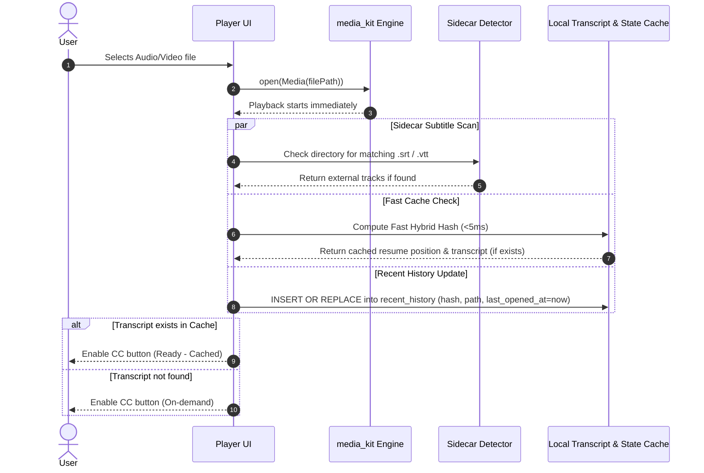
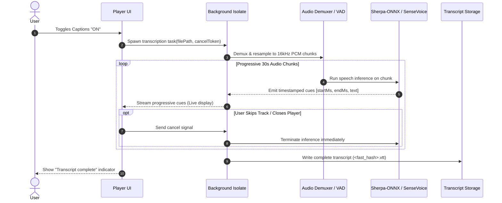

# EasyPlayer: Architecture & Development Plan

## 1. Executive Summary & Core Decisions

EasyPlayer is a cross-platform (Windows & Android) media player supporting all popular audio and video formats, featuring offline, on-device speech-to-text (ASR) that generates synchronized captions with zero server dependencies.

### Core Decisions
- **Project Name**: **EasyPlayer** (plays both audio and video formats).
- **Developer / Publisher**: **PandaSoft**
- **Application ID / Package Name**:
  - Android: `com.pandasoft.easyplayer`
  - Windows: `PandaSoft.EasyPlayer`
- **Branding & Visual Identity**:
  - Official PandaSoft logos and multi-resolution icons located in `artwork/`.
  - Windows: High-DPI `.ico` icons (`logo_256x256.ico`, `logo_48x48.ico`, `logo_32x32.ico`, `logo_16x16.ico`) for executable, window title bar, and taskbar.
  - Android: High-resolution PNGs (`logo_transparent.png`, `logo_no_bg.png`) and adaptive icon configurations (`logo_108x108.ico`) for launcher mipmaps and splash/about dialogs.
- **Model Distribution**: Primary model is quantized **SenseVoice-Small INT8** (~75 MB via `sherpa_onnx`). Selected over Whisper Base INT8 for superior Mandarin accuracy and native audio-event token support. Supports English, Simplified Chinese, and mixed speech with high speed (<0.15 RTF) on mobile CPUs. Bundled directly in application assets.
- **Playback & Transcription UX**: **Instant Playback**. Audio/video plays immediately with no loading screen. Captions are toggled on-demand and generated progressively in a background Dart Isolate.
- **Fast Hybrid Hashing & Instant Caching**: Replaced full-file hashing with a high-speed hybrid algorithm:
  $$\text{Hash} = \text{SHA-256}(\text{file\_size} + \text{first\_64KB} + \text{middle\_64KB} + \text{last\_64KB})$$
  Executes in $<5\text{ ms}$ on multi-gigabyte media files. Transcripts and resume playback positions are cached locally keyed by this hash.
- **Task Preemption**: Background extraction and transcription are instantly cancelled if the user skips tracks or changes media.

---

## 2. Technology Stack & Platform Dependency Matrix

| Layer | Component | Android (ARM64) Package | Windows (x64) Package | Notes / Rationale |
| :--- | :--- | :--- | :--- | :--- |
| **Framework** | Flutter SDK 3.22+ / Dart 3.4+ | Android NDK r25+ | MSVC v143 / C++17 | Cross-platform single codebase |
| **Media Player** | `media_kit ^1.1.10` | `media_kit_libs_android_video` | `media_kit_libs_windows_video` | `libmpv` + FFmpeg runtime bindings |
| **Video Surface**| `media_kit_video ^1.0.6` | `media_kit_video` | `media_kit_video` | Hardware texture rendering |
| **Subtitle Renderer** | `libass` (bundled within `media_kit_libs_*`) | Included in `media_kit_libs_android_video` | Included in `media_kit_libs_windows_video` | ASS/SSA advanced subtitle styling & karaoke |
| **Speech Engine**| `sherpa_onnx ^1.9+` | JNI native binaries (`arm64-v8a`) | Native `sherpa-onnx.dll` (x64) | On-device ONNX runtime engine |
| **Database** | SQLite Store | `sqflite ^2.3+` | `sqflite_common_ffi ^2.3+` | Caching playback positions & metadata |
| **Hashing** | `crypto ^3.0` (Dart) | `crypto` | `crypto` | SHA-256 for Fast Hybrid Hash algorithm |
| **Charset** | Encoding Sniffer | `charset_converter` | `charset_converter` / `fast_gbk` | GBK / UTF-16 auto-detection |
| **App Storage** | Storage Paths | `path_provider ^2.1+` | `path_provider ^2.1+` | Resolves app support & public directories |
| **i18n** | `flutter_localizations` + `intl` | (first-party Flutter) | (first-party Flutter) | English & 简体中文 `.arb` string catalogs |
| **Drag-and-Drop** | `flutter_drop_region` | — | `flutter_drop_region` | Windows file & folder drop target |
| **Android SDK** | Min/Target API | `minSdkVersion 29` | — | Min: Android 10; Target: API 35 (Android 15) |

---

## 3. System Architecture & Data Contracts

```mermaid
flowchart TD
    subgraph UI ["User Interface (Flutter)"]
        PV["Player Viewport (Video Frame / Album Art & Visualizer)"]
        Overlay["On-Video Subtitle Overlay"]
        Sidebar["Interactive Transcript Panel (Click to Seek & Search)"]
        Controls["Playback Controls (Play/Pause, Seek, Speed, CC, PiP)"]
        TrackMenu["Subtitle Selector (Embedded, Sidecar, Generated)"]
    end

    subgraph State ["State & Coordination"]
        PC["Player Controller (media_kit)"]
        CC["Caption Controller & Cancellation Manager"]
        Sync["Sync Engine (Binary Search Cue Lookup)"]
        Queue["Queue & Folder Navigator (Natural Sorting)"]
        Sidecar["Sidecar Subtitle Detector (.srt / .vtt)"]
    end

    subgraph Worker ["Background Worker (Dart Isolate)"]
        Demux["Audio Demuxer & Resampler (16kHz Mono PCM)"]
        VAD["Voice Activity Detector (Filters Silence)"]
        ASR["ASR Inference (SenseVoice-Small / Sherpa-ONNX)"]
    end

    subgraph Storage ["Local Storage"]
        Cache[("Transcript & Position Cache (<fast_hash>.vtt)")]
        ModelAsset["Bundled Model Weights (~75 MB INT8)"]
    end

    Controls --> PC
    Controls -->|Toggle CC| CC
    Controls --> TrackMenu
    Queue --> PC
    PC -->|Media Open| Sidecar
    PC -->|Media Open| Cache
    PC -->|Position Stream (ms)| Sync
    Sidecar --> TrackMenu
    CC -->|Check Cache| Cache
    CC -->|If Miss: Spawn Worker| Demux
    CC -->|On Track Skip: Cancel Token| Worker
    Demux --> VAD
    VAD --> ASR
    ASR -->|Progressive Cues Stream| CC
    ASR -->|Save Completed| Cache
    ModelAsset -.->|Extracted on First Run| ASR
    CC --> Sync
    Sync --> Overlay
    Sync --> Sidebar
    Sidebar -->|Seek to Timestamp| PC
```

### 3.1. Core Data Models & State Contracts

```dart
/// Represents a media item in the playlist or folder queue
class MediaItem {
  final String id;              // FastHybridHash
  final String filePath;        // Absolute path
  final String fileName;        // Display name
  final String extension;       // File extension (e.g. mp4, mkv, mp3)
  final int fileSizeBytes;
  final Duration? duration;
  final bool isVideo;
  final String? title;          // From ID3/Vorbis tags
  final String? artist;
  final String? album;
  final String? coverArtPath;   // Cached thumbnail path
  final bool hasCachedTranscript;
  final int? resumePositionMs;  // Last saved playback position (for Recently Played shelf & resume)
  final DateTime? lastOpenedAt; // Timestamp of last open event (used to rank Recently Played shelf)

  const MediaItem({
    required this.id,
    required this.filePath,
    required this.fileName,
    required this.extension,
    required this.fileSizeBytes,
    this.duration,
    required this.isVideo,
    this.title,
    this.artist,
    this.album,
    this.coverArtPath,
    this.hasCachedTranscript = false,
    this.resumePositionMs,
    this.lastOpenedAt,
  });
}

/// Represents a single synchronized caption cue
class SubtitleCue {
  final int id;
  final int startMs;
  final int endMs;
  final String text;
  final bool isEdited;
  final String? audioEventTag;  // e.g. "[Laughter]", "[Applause]"

  const SubtitleCue({
    required this.id,
    required this.startMs,
    required this.endMs,
    required this.text,
    this.isEdited = false,
    this.audioEventTag,
  });
}

/// ASR Background Task Lifecycle
/// modelLoading / unloaded distinguish the model's own load state from the transcription task state.
/// This allows the UI to show a "loading model..." indicator on first CC enable (cold start, ~1–2s)
/// vs. a "ready" indicator when the model is already resident in memory.
enum ASRStatus {
  unloaded,        // Model not in memory (baseline; CC was never toggled or idle timer fired)
  modelLoading,    // Lazy-loading ONNX session (first CC enable or post-unload re-enable)
  idle,            // Model loaded and resident; no transcription task active
  extractingAudio, // Demuxing & resampling audio to 16kHz PCM
  transcribing,    // Active ONNX inference (progressive cue emission)
  completed,       // Transcription finished; transcript written to cache
  cancelled,       // Task preempted (track skip or player close)
  error            // Inference or extraction failure
}

class ASRState {
  final ASRStatus status;
  final double progress;        // 0.0 to 1.0
  final List<SubtitleCue> cues; // Progressive live stream
  final String? errorMessage;

  const ASRState({
    required this.status,
    this.progress = 0.0,
    this.cues = const [],
    this.errorMessage,
  });
}
```

### 3.2. Recently Played — Data Model & Storage

The **Recently Played** home-screen shelf requires richer structure than the flat `playback_positions` map (settings key 23). A dedicated `recent_history` table is maintained in `easyplayer.db` (at `<App_Data_Directory>/database/easyplayer.db`, matching the storage layout in Functional Spec §8):

```sql
CREATE TABLE recent_history (
  fast_hash       TEXT PRIMARY KEY,
  file_path       TEXT NOT NULL,
  file_name       TEXT NOT NULL,
  cover_art_path  TEXT,
  duration_ms     INTEGER,
  resume_pos_ms   INTEGER NOT NULL DEFAULT 0,
  last_opened_at  INTEGER NOT NULL   -- Unix epoch ms; used for ordering
);
```

- The table is capped at **20 rows**; on each `INSERT OR REPLACE`, if the count exceeds 20, the oldest row (by `last_opened_at`) is deleted.
- **Deduplication**: Because `fast_hash` is the PRIMARY KEY, reopening the same file simply updates its `resume_pos_ms` and `last_opened_at` — it does not add a second row.
- The "Clear Playback History" privacy action executes `DELETE FROM recent_history` and also purges the flat `playback_positions` map from SharedPreferences.
- When `record_playback_history = false`, no rows are inserted (the table is left as-is).

---

## 4. Key Workflows

### 4.1. File Open & Instant Playback


### 4.2. On-Demand Background Transcription & Preemption


---

## 5. Phased Implementation Roadmap

### Phase 1: Core Player Foundation (Milestone 1)
- [x] Initialize Flutter project `easy_player` (package `com.pandasoft.easyplayer`) with Windows and Android build configurations. Set `minSdkVersion 29`, `targetSdkVersion 35`.
- [x] Configure `media_kit ^1.1.10` and `media_kit_video ^1.0.6` dependencies with hardware decoding enabled and software CPU fallback (`hwdec=auto-safe`).
- [x] Integrate PandaSoft artwork and logo assets from `artwork/` into Windows application assets and Android mipmap resources.
- [x] Build responsive player interface:
  - Video viewport with aspect ratio selector (Fit/Letterbox, Fill/Crop, Stretch, Fixed 16:9, Fixed 4:3).
  - Smart fullscreen auto-rotation (Landscape for 16:9, Portrait for 9:16 vertical clips).
  - Display cutout / notch handling (`LAYOUT_IN_DISPLAY_CUTOUT_MODE_SHORT_EDGES`) for edge-to-edge fullscreen on Android.
  - Audio mode (ID3/Vorbis album art rendering, responsive waveform visualizer).
  - Playback controls: Play/Pause, Seek bar, Time elapsed/remaining, Speed selector with pitch correction, Volume, Fullscreen.
  - Multi-audio track selector (switch between language dubs / audio streams).
  - Audio enhancement: Loudness normalization (`--af=loudnorm`) and vocal clarity boost filter (`lavfi=[highpass=f=80,equalizer=...]`).
  - Sleep timer with smooth 15s audio fade-out (presets: 15m, 30m, 45m, 60m, end-of-track). Persist `sleep_timer_mode` setting.
  - Native-resolution video frame snapshot: hotkey `S`, PNG save via `path_provider` (Windows) / `MediaStore.Images.Media.insert()` (Android API 29+), `snapshot_include_subtitles` toggle.
- [x] Implement directory queue navigator with natural sorting (`1, 2, 10`) and flat/recursive scan toggle.
- [x] Implement **lazy asynchronous metadata extraction**: file names and sizes populate instantly; ID3/Vorbis tags and album art are extracted on a background Dart isolate only as items scroll into view, targeting 60/120 FPS scroll performance on directories with hundreds of files.
- [x] Add error resilience: Graceful auto-skip on corrupted or unreadable media files in queue.
- [x] Auto-detect sidecar subtitles (`.srt`, `.vtt`, `.ass`, `.ssa`) in media directory with native `libass` rendering.
- [x] Implement **ASS/SSA styling override toggle** (`override_ass_styling`): when enabled, forces EasyPlayer's standard subtitle typography instead of fansub-defined fonts and positions.
- [x] Test universal format support (MP3, FLAC, AAC, MP4, MKV, WebM, 10-bit Hi10P).

### Phase 2: Speech Engine & Model Integration (Milestone 2)
- [x] Bundle lightweight quantized SenseVoice-Small INT8 model (~75 MB) into Flutter assets (`assets/models/sensevoice_small_int8/`).
- [x] Implement asset extraction utility: unpacks model to app data directory on first run; detects and re-extracts on partial/corrupt extraction (size/checksum validation).
- [x] Set up background Dart Isolate with cancellation token support for task preemption.
- [x] Configure ONNX Runtime thread pooling (`intra_op_num_threads = 2` on mobile, `4` on Windows) and low-battery guard (pause ASR below 15% battery, not on charger).
- [x] Implement **lazy load / auto-unload lifecycle**: model is NOT loaded at app boot; lazily initializes only when CC is first toggled ON (emitting `ASRStatus.modelLoading`). After a transcription job completes or is cancelled, start a 3-minute idle timer; if no new transcription is requested, unload the ONNX session (`ASRStatus.unloaded`) and release ~75 MB back to the OS.
- [x] Implement 16kHz audio extraction pipeline targeting the active audio track for both audio files and video containers (MP4, MKV, WebM).
- [x] Integrate VAD (Voice Activity Detection) to gracefully handle instrumental music and silence.
- [x] Implement smart sentence segmentation (35–42 chars max, punctuation/pause split) and SenseVoice audio event sanitization (`[Laughter]`, `[Applause]`).
- [x] Produce structured cue objects: `{ id, startMs, endMs, text }`.

### Phase 3: Caption Synchronization & Dual-Mode UI (Milestone 3)
- [x] Implement the `SubtitleSyncEngine` with $O(\log n)$ binary search lookup.
- [x] Integrate automatic charset / encoding detection (`GBK`, `GB18030`, `UTF-8`, `Big5`, `UTF-16`) to prevent Chinese subtitle mojibake.
- [x] Implement subtitle timing offset / delay adjustment (`+/- 100ms`, `[-10s, +10s]`).
- [x] Connect `player.stream.position` to caption sync engine.
- [x] Build **On-Video Subtitle Overlay** with customizable text size, high-contrast background styling, and **vertical bottom margin slider** (`subtitle_bottom_margin_percent`, default 8%, range 4%–35%) to avoid collision with burned-in subtitles or media controls.
- [x] Build **Interactive Transcript Sidebar**:
  - Auto-scrolls to keep current sentence visible (locked mode).
  - Floating **"Resume Auto-scroll"** button appears when user manually scrolls; tapping it re-locks view to current playback position.
  - Clicking any sentence seeks the player directly to that timestamp.
  - In-transcript real-time search with match navigation (e.g. `3 of 14`).
  - Inline editing of recognized text blocks with `isEdited` flag persisted as VTT `NOTE` metadata.
  - "Loop Sentence" A-B repeat micro-action.
- [x] Implement A-B Repeat loop mode (hotkey `R` / UI toggle).
- [x] Subtitle track selector: Embedded tracks, External Sidecars, and Auto-Generated Captions.
- [x] Language toggle: Auto-Detect (default), English, 简体中文.
- [x] Accessibility: Semantic screen-reader announcements (`Semantics`) and logical Tab focus traversal on Windows.

### Phase 4: Caching, Persistence & File Management (Milestone 4)
- [x] Implement Fast Hybrid Hashing algorithm: $\text{SHA-256}(\text{size} + \text{first\_64K} + \text{mid\_64K} + \text{last\_64K})$ running in $<5\text{ ms}$.
- [x] Implement deterministic local storage directory layout (`models/`, `transcripts/`, `cache/album_art/`, `database/`).
- [x] Implement SQLite store (`easyplayer.db`) with:
  - `playback_positions` map (hash → position_ms) for per-file resume.
  - `recent_history` table (20-row cap, `last_opened_at` ordering) for the Recently Played shelf. See §3.2 data model.
  - `settings` table for all 27 persistent settings keys.
- [x] Build **Recently Played home-screen shelf**: displays last 20 opened files with thumbnail, duration, and resume progress bar. Populated from `recent_history` table.
- [x] Implement **"Clear Playback History"** privacy action: purges `recent_history` table and `playback_positions` SharedPreferences map.
- [x] Implement transcript store: Save completed and edited transcripts as WebVTT (`.vtt`) in app data storage keyed by fast hash. Handle disk-full write failure gracefully (retain in-memory cues, surface "Export Now" action).
- [x] Add Storage & Cache UI in Settings with "Clear Cache" button (purges transcripts/thumbnails while preserving models).
- [x] Add cross-platform transcript sharing: Windows export (`.srt`, `.vtt`, `.txt`) and Android native Share Sheet (`Intent.ACTION_SEND`).
- [x] Handle Android Scoped Storage / Storage Access Framework (SAF) folder picker permissions cleanly.

### Phase 5: Platform Polish & Packaging (Milestone 5)
- [ ] Android touch gestures: brightness (left vertical), volume (right vertical), scrubbing (horizontal), double-tap 10s seek and center play/pause.
- [ ] Android wired/Bluetooth headset click controls: single-click play/pause, double-click next track, triple-click previous track.
- [ ] Android audio focus management: auto-pause on headphone/Bluetooth disconnect (`ACTION_AUDIO_BECOMING_NOISY`).
- [ ] Android predictive back navigation hierarchy (4-level priority: Search → Sidebar → Fullscreen → Background).
- [ ] Android native Picture-in-Picture (PiP) for video playback, including `RemoteAction` buttons (play/pause). If PiP is disabled by the system, video pauses on app minimize (standard media player convention).
- [ ] Display & power management: Android screen WakeLock (`FLAG_KEEP_SCREEN_ON`) and Windows `SetThreadExecutionState` sleep prevention.
- [ ] Full app UI internationalization (English & 简体中文) via `flutter_localizations` (`.arb`).
- [ ] Windows System Media Transport Controls (SMTC) integration and Taskbar Thumbnail Toolbar.
- [ ] Windows single-instance IPC (Named Pipe) and file associations registration.
- [ ] **Windows mouse ergonomics**:
  - Mouse wheel over video viewport: adjust volume by ±5%.
  - Left double-click on video viewport: enter/exit Fullscreen.
  - Right-click context menu: Audio Track selector, Subtitle Tracks & timing offset, Playback Speed presets, Aspect Ratio modes, A-B Repeat toggle, Video Snapshot capture.
- [ ] **Windows drag-and-drop**: accept media file(s) or folder drops onto the window via `DropTarget` / `flutter_drop_region`; file drop plays immediately, folder drop loads queue from first file.
- [ ] Windows keyboard shortcuts (full hotkey table per §6.2 of Functional Spec) and **Always-on-Top mini-player** mode (hotkey `T`, persisted via `mini_player_always_on_top` setting).
- [ ] Android background audio playback service with `FOREGROUND_SERVICE_MEDIA_PLAYBACK`, notification channel (`channel_id: "easyplayer_playback"`, importance: `IMPORTANCE_LOW`) created on first launch, and lock screen notification controls (`POST_NOTIFICATIONS` runtime prompt on API 33+).
- [ ] Windows packaging (MSIX / standalone executable) signed as PandaSoft with official icon assets, and Android signed release APK verification.

---

## 6. Standardized Test & Verification Matrix

To ensure stability across formats, locales, and device specifications, implementation must be validated against a strict test matrix:

| Test Category | Target Scenarios & Sample Artifacts | Acceptance Criteria |
| :--- | :--- | :--- |
| **Media Codecs** | MP4 (H.264), MKV (HEVC & 10-bit Hi10P), WebM (VP9/AV1), MP3, FLAC, WAV, M4A, OGG | Zero dropped frames on 1080p/4K; graceful CPU fallback on unsupported GPU codecs. |
| **Subtitle Formats** | UTF-8 `.srt`, GBK `.srt`, UTF-16 `.srt`, `.vtt`, `.ass` / `.ssa` (with stylized fonts) | No mojibake (corrupted text); `.ass` styling renders natively; delay offset adjusts in real time; override toggle forces clean EasyPlayer typography. |
| **ASR Inference** | 30s English speech, 30s Mandarin Chinese, 30s mixed code-switching, 30s silence/music | Accurate cues generated on background isolate; VAD rejects pure silence without emitting errors. |
| **ASR Lifecycle** | Toggle CC ON (cold start), wait 3+ minutes idle, toggle CC ON again (re-load) | `ASRStatus.modelLoading` emitted on first enable; model unloads after 3-min idle (`ASRStatus.unloaded`); cold re-start completes in ≤ 2s; memory footprint drops ~75 MB after unload. |
| **Algorithmic Units** | `FastHybridHash` benchmarking; `SubtitleSyncEngine` binary search | Hash computation $< 5\text{ ms}$ on 10GB+ files; cue lookup $< 0.1\text{ ms}$ per video frame on 1,000+ cues. |
| **Queue Resilience** | Playlist containing zero-byte, corrupted, and valid media files | Corrupted files trigger a non-blocking toast and auto-advance to next valid track in $\le 1\text{s}$. |
| **Sleep Timer** | Set timer to 15 min; set to "end of track"; cancel mid-countdown | Audio fades out smoothly over 15s before expiry; playback stops; WakeLock released. "End of track" stops after current file. Cancel immediately halts countdown. |
| **A-B Repeat** | Set A/B markers manually; use "Loop Sentence" transcript micro-action | Playback loops accurately between markers (±50ms tolerance); "Loop Sentence" sets exact cue boundaries; `R` hotkey toggles. |
| **Recently Played & Resume** | Open 25 files; reopen one; use "Clear History" | Shelf shows most recent 20 (oldest dropped); reopening resumes from saved position; "Clear History" empties shelf and position map. |
| **Snapshot Capture** | Capture on 4K video without subtitles; capture with `snapshot_include_subtitles=true`; capture on Android | Windows: PNG saved to `Pictures\EasyPlayer\`; Android: image visible in gallery via MediaStore; resolution matches native video resolution; subtitle text composited when setting is on. |
| **Android PiP** | Enter PiP during playback; exit PiP; disable PiP in device settings then minimize app | PiP enters with play/pause `RemoteAction`; exiting PiP resumes full-screen player; when PiP disabled, video pauses on minimize. |
| **Windows SMTC** | Play media; use hardware media keys; check taskbar thumbnail toolbar | SMTC overlay shows correct title/artist/art; `MediaPlayPause`, `MediaNextTrack`, `MediaPreviousTrack` keys respond correctly; taskbar mini-buttons visible on hover. |
| **Transcript Edit & Persist** | Edit a cue text; close app; reopen same file (cached transcript) | Edited text survives app restart; `NOTE edited=true` metadata present in saved `.vtt`; "Edited" badge shown on corrected cue in transcript panel. |
| **Lifecycle Safety** | Headphone unplugging, app minimization, incoming calls | Audio pauses immediately on headphone disconnect; video resumes smoothly from background. |
| **i18n / Locale** | Switch `ui_language` between `en` and `zh_CN` at runtime; relaunch app with each locale | All UI strings, labels, and number formats update correctly with no missing `.arb` keys; no layout overflow on longer Chinese strings. |
