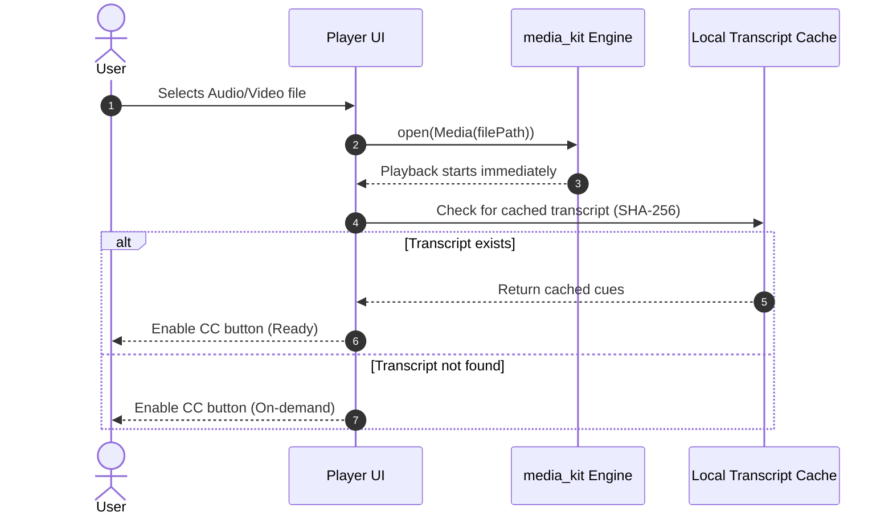
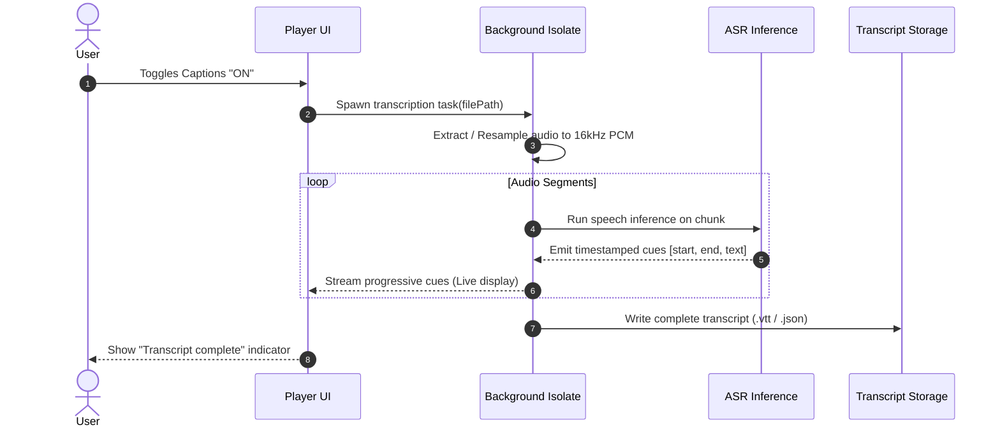

# EasyPlayer: Architecture & Development Plan

## 1. Executive Summary & Core Decisions

EasyPlayer is a cross-platform (Windows & Android) media player supporting all popular audio and video formats, featuring offline, on-device speech-to-text (ASR) that generates synchronized captions with zero server dependencies.

### Core Decisions
- **Project Name**: **EasyPlayer** (plays both audio and video formats).
- **Model Distribution**: A lightweight quantized model (~40–75 MB, INT8 Whisper / Sherpa-ONNX) is bundled inside the app assets.
- **Playback & Transcription UX**: **Instant Playback**. Audio/video plays immediately with no loading screen. Captions are toggled on-demand and generated progressively in a background thread.
- **Transcript Persistence**: Transcripts are automatically cached locally as standard `.vtt` / `.json` files keyed by the media file's unique hash. Reopening a previously played file instantly loads the cached transcript.

---

## 2. Technology Stack

| Layer | Component | Details |
| :--- | :--- | :--- |
| **Framework** | Flutter (Dart) | Single codebase for Windows Desktop (x64) and Android (ARM64). |
| **Media Playback** | `media_kit` + `media_kit_video` | Powered by `libmpv` (FFmpeg). Plays all audio (MP3, FLAC, WAV, AAC, Opus, OGG, M4A) and video (MP4, MKV, WebM, AVI, MOV). |
| **Speech Engine** | `sherpa_onnx` / `whisper_flutter_plus` | Cross-platform on-device inference using quantized models (runs on background Isolate). |
| **State Management** | Flutter Riverpod or ValueNotifiers | Reactive streams for playback position, transcription status, and active subtitle cue. |
| **Storage & Cache** | `path_provider` + `crypto` | Caching transcripts in app data directory using SHA-256 media hashing. |

---

## 3. System Architecture

```mermaid
flowchart TD
    subgraph UI ["User Interface (Flutter)"]
        PV["Player Viewport (Audio Visualizer / Video Frame)"]
        Overlay["On-Video Subtitle Overlay"]
        Sidebar["Interactive Transcript Panel (Click to Seek)"]
        Toggle["Caption Toggle Button (CC)"]
    end

    subgraph State ["State & Coordination"]
        PC["Player Controller (media_kit)"]
        CC["Caption Controller"]
        Sync["Sync Engine (Binary Search Cue Lookup)"]
    end

    subgraph Worker ["Background Worker (Dart Isolate)"]
        AE["Audio Resampler / Extractor (16kHz Mono)"]
        ASR["ASR Inference (Sherpa-ONNX / Whisper)"]
    end

    subgraph Storage ["Local Storage"]
        Cache[("Transcript Cache (.vtt / .json)")]
        ModelAsset["Bundled Model Weights (.onnx / .bin)"]
    end

    PV --> PC
    Toggle -->|Enable CC| CC
    PC -->|Position Stream (ms)| Sync
    CC -->|Check Cache| Cache
    CC -->|If Miss: Start Job| AE
    AE --> ASR
    ASR -->|Progressive Cues Stream| CC
    ASR -->|Save Completed| Cache
    ModelAsset -.->|Extracted on First Run| ASR
    CC --> Sync
    Sync --> Overlay
    Sync --> Sidebar
    Sidebar -->|Seek to Timestamp| PC
```

---

## 4. Key Workflows

### 4.1. File Open & Instant Playback


### 4.2. On-Demand Background Transcription


---

## 5. Phased Implementation Roadmap

### Phase 1: Core Player Foundation (Milestone 1)
- [ ] Initialize Flutter project `easy_player` with Windows and Android build configurations.
- [ ] Configure `media_kit` and `media_kit_video` dependencies.
- [ ] Build responsive player interface:
  - Video viewport (auto-scales with aspect ratio).
  - Audio mode (metadata, waveform/placeholder visualizer).
  - Playback controls: Play/Pause, Seek bar, Time elapsed/remaining, Volume, Fullscreen.
- [ ] Test universal format support (MP3, FLAC, AAC, MP4, MKV, WebM).

### Phase 2: Speech Engine & Model Integration (Milestone 2)
- [ ] Bundle lightweight quantized ASR model into Flutter assets.
- [ ] Implement asset extraction utility (unpacks model to app data directory on first run).
- [ ] Set up background Dart Isolate for speech inference.
- [ ] Implement 16kHz audio extraction pipeline for both audio files and video containers.
- [ ] Produce structured cue objects: `{ startMs, endMs, text }`.

### Phase 3: Caption Synchronization & Dual-Mode UI (Milestone 3)
- [ ] Implement the `SubtitleSyncEngine` with $O(\log n)$ binary search lookup.
- [ ] Connect `player.stream.position` to caption sync engine.
- [ ] Build **On-Video Subtitle Overlay** with customizable text size and background styling.
- [ ] Build **Interactive Transcript Sidebar**:
  - Auto-scrolls to keep current sentence visible.
  - Clicking any sentence seeks the player directly to that timestamp.
- [ ] Implement the CC toggle button with progressive live rendering during transcription.

### Phase 4: Caching, Persistence & File Management (Milestone 4)
- [ ] Generate unique hash (SHA-256 or quick header hash) for loaded media files.
- [ ] Implement transcript store: Save completed transcripts as WebVTT (`.vtt`) or JSON in app data storage.
- [ ] Add transcript export function (allow user to export `.vtt` or `.txt` file).
- [ ] Handle Android Scoped Storage / Storage Access Framework permissions cleanly.

### Phase 5: Platform Polish & Packaging (Milestone 5)
- [ ] Android background audio playback service & lock screen notification controls.
- [ ] Windows keyboard shortcuts (Space for pause, arrows for seeking, F for fullscreen).
- [ ] Windows MSIX / executable packaging and Android APK build verification.
