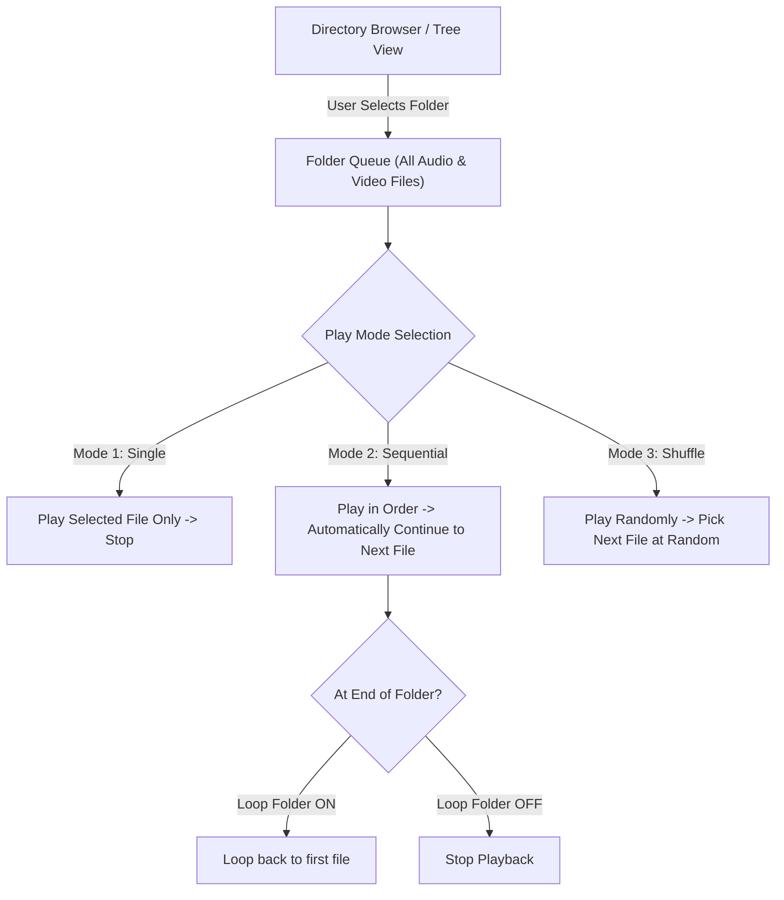

# EasyPlayer: Complete Functional Specification

**Version:** 1.0  
**Target Platforms:** Windows PC (x64) & Android (ARM64)  
**Status:** Approved Specification  

---

## 1. Product Overview & Core Vision
**EasyPlayer** is a cross-platform media player for Windows and Android engineered to play all popular audio and video formats, developed by **PandaSoft**. It combines a folder-based queue player with an on-device, offline Automatic Speech Recognition (ASR) engine capable of transcribing speech (English and Simplified Chinese) on-demand, generating synchronized subtitles and an interactive, editable transcript.

### 1.1. Developer & Branding Identity
- **Developer / Organization**: **PandaSoft**
- **Android Application ID / Package**: `com.pandasoft.easyplayer`
- **Windows Package Identity**: `PandaSoft.EasyPlayer`
- **Branding Assets & Logo Integration**:
  - `artwork/logo_256x256.ico`: High-resolution Windows application executable icon.
  - `artwork/logo_48x48.ico`, `logo_32x32.ico`, `logo_16x16.ico`: Multi-size Windows taskbar and title bar icons.
  - `artwork/logo_108x108.ico`: Android adaptive launcher icon foreground reference.
  - `artwork/logo_transparent.png`: High-resolution (1024x1024) transparent branding logo for splash screen, in-app About dialog, and Android notification/drawer assets.
  - `artwork/logo_no_bg.png`: Clean 1024x1024 brand graphic.

### 1.2. Android Platform Requirements
- **Minimum SDK (`minSdkVersion`)**: API 29 (Android 10) — required to support `READ_EXTERNAL_STORAGE` for the Android 10–12 storage path.
- **Target SDK (`targetSdkVersion`)**: API 35 (Android 15) — ensures compliance with current Play Store submission requirements.
- **Compile SDK**: API 35.
- **Key API-level branch points**:
  - Scoped storage permissions: `READ_MEDIA_AUDIO` / `READ_MEDIA_VIDEO` on API 33+; `READ_EXTERNAL_STORAGE` on API 29–32.
  - MediaStore image insert for snapshots: `MediaStore.Images.Media.insert()` on API 29+.
  - Foreground service type declaration: `FOREGROUND_SERVICE_MEDIA_PLAYBACK` on API 34+ (Android 14+).
  - Runtime notification permission: `POST_NOTIFICATIONS` prompt on API 33+ (Android 13+).

### 1.3. Application UI Internationalization (i18n)
- **Supported Languages**: **English** and **Simplified Chinese (简体中文)**.
- **Locale Adaptation**:
  - `Follow System (Default)`: UI language automatically detects and mirrors the operating system locale.
  - `In-App Language Selector`: Settings allows users to manually lock the UI language to English or 简体中文 regardless of system locale.
- **Architecture**: Managed via Flutter standard localization (`flutter_localizations` with `.arb` string catalogs).

### 1.4. Architecture Scope & Future Streaming Extensibility
- **Core Scope**: Offline-first media player optimized for local device storage, SD cards, and USB OTG drives.
- **Streaming Readiness**: Because the playback layer uses `media_kit` (backed by `libmpv`), the engine's internal URI handling accepts arbitrary protocols (`file://`, `http://`, `https://`). Network streaming (direct HTTP/HLS URLs and local LAN SMB/WebDAV shares) can be surfaced in future updates without refactoring player or caption state machines.

---

## 2. Media Playback & Engine Specifications

### 2.1. Supported Containers & Codecs
Powered by `libmpv` (FFmpeg backend via `media_kit`):
- **Audio**: MP3, FLAC, WAV, AAC, M4A, OGG, Opus, WMA, ALAC, AIFF, APE.
- **Video**: MP4, MKV, WebM, AVI, MOV, FLV, WMV, TS, 3GP (including 10-bit H.264 Hi10P, HEVC, AV1, VP9).
- **Hardware Acceleration with Safe CPU Fallback (`hwdec=auto-safe`)**:
  - Automatically offloads video decoding to native GPU hardware decoders (Direct3D 11 / D3D11VA on Windows, MediaCodec on Android).
  - If a specific GPU hardware decoder fails or cannot decode exotic video streams (e.g. 10-bit anime encodes), the player **automatically falls back to software CPU decoding** without dropped frames, black screens, or player crashes.
  - The `hardware_acceleration` setting (key 13) controls this: `true` (default) uses `hwdec=auto-safe`; `false` forces `hwdec=no` for pure software decoding on systems with problematic GPU drivers.

### 2.2. Playback Controls
- **Core Operations**: Play, Pause, Scrub/Seek slider, Time Elapsed / Time Remaining.
- **Variable Playback Speed**: 0.5x, 0.75x, 1.0x, 1.25x, 1.5x, 2.0x with **pitch correction** enabled (voices remain natural).
- **Configurable Jump Times**:
  - Quick skip backward (Default: 5s, configurable: 3s, 5s, 10s, 15s, 30s).
  - Quick skip forward (Default: 10s, configurable: 5s, 10s, 15s, 30s, 60s).
- **Playback Position Memory (Resume Playback)**:
  - Last playback position saved per file hash (using Fast Hybrid Hash).
  - When re-opened, media resumes automatically from the last timestamp (with an option to restart from 0:00).
- **Audio Track Switching & ASR Source Targeting**:
  - For media with multiple audio streams (e.g. MKV/MP4 containing multi-language dubs or commentary tracks):
    - User can select their desired active audio track from the Audio Track menu.
    - **ASR Stream Binding**: When auto-transcription is requested, the ASR pipeline extracts and transcribes the **currently active audio track** (defaulting to primary Track 1 if unselected).
- **Subtitle Track Switching & ASS/SSA Styling Support**:
  - Flexible subtitle source selection:
    1. *None (Off)*
    2. *Embedded Subtitle Tracks (Track 1, Track 2, etc. from MKV/MP4, including native `.ass` / `.ssa` / `.sub`)*
    3. *External Sidecar Subtitles (Auto-detected `.srt`, `.vtt`, `.ass`, `.ssa` in the same directory sharing the media's base name)*
    4. *EasyPlayer Auto-Generated Captions*
  - **Advanced SubStation Alpha (`.ass` / `.ssa`) Handling**:
    - By default, `libmpv` renders specialized fonts, screen positioning, colors, and karaoke effects via embedded `libass`.
    - **Override ASS Styling Toggle**: Subtitle Settings provides an option to force standardized EasyPlayer typography (clean font, high-contrast box) if complex fansub styles are illegible on mobile displays.
- **Subtitle Timing Delay Adjustment**:
  - Adjustable offset slider and stepper (`+/- 100ms`, range: `-10.0s` to `+10.0s`) to fine-tune synchronization of external sidecar subtitles with audio.
- **A-B Repeat Looping Mode**:
  - Designed for language learning, interview transcription, and lecture study:
    - User sets Marker A (start timestamp) and Marker B (end timestamp) to continuously loop any segment.
    - **Incomplete Marker Behavior**: If the user activates A-B Repeat with only Marker A set (no Marker B), Marker B is automatically placed at the **current playback position** at the moment of activation. If the current position is at or before Marker A, the repeat is not activated and a brief tooltip reads *"Set Marker B first."*
    - Interactive Transcript micro-action: Clicking "Loop Sentence" on any cue block automatically creates an A-B loop spanning that exact cue's duration.
    - Toggle on/off via UI button or hotkey (`R`).
- **Sleep Timer (Auto-Off)**:
  - Accessible via player controls and settings menu:
    - Presets: `15 minutes`, `30 minutes`, `45 minutes`, `60 minutes`, or `Custom duration`.
    - Smart option: *"Stop after current track finishes"*.
    - **Smooth Fade-Out**: In the final 15 seconds before expiration, audio volume gently fades out, playback pauses, and the system WakeLock is released, allowing the device to enter sleep mode safely.
    - **Interaction with A-B Repeat**: If the Sleep Timer expires while A-B Repeat is active, the timer takes priority — the fade-out and stop sequence executes normally. A-B Repeat does not prevent sleep timer expiry.

### 2.3. Video Scaling, Aspect Ratio & Smart Orientation
- **Aspect Ratio Selector**:
  1. *Fit / Letterbox (Default)*: Preserves exact native video aspect ratio with clean black borders.
  2. *Fill / Crop (Zoom)*: Expands video to fill viewport completely, eliminating black bars on modern ultrawide phone screens (e.g. 19.5:9 / 20:9) or monitors.
  3. *Stretch*: Scales video directly to fit viewport bounds regardless of aspect ratio.
  4. *Fixed 16:9 / 4:3 Presets*: Corrects anamorphic stretch issues in legacy video files.
- **Smart Fullscreen Auto-Rotation (Android)**:
  - When entering fullscreen:
    - If video width $\ge$ height (landscape): Device automatically rotates to Landscape (`SensorLandscape`).
    - If video height > width (vertical clips/Shorts): Retains Portrait orientation.
  - Exiting fullscreen restores the user's prior screen orientation state.
  - Manual orientation override toggle: `[Auto Sensor, Force Landscape, Force Portrait]`.
- **Display Cutout / Notch Handling (Android)**:
  - Video viewport extends smoothly around camera pinholes and display notches (`LAYOUT_IN_DISPLAY_CUTOUT_MODE_SHORT_EDGES`) during fullscreen playback.

### 2.4. Audio Normalization & Vocal Clarity Boost
- **Dynamic Loudness Normalization (`--af=loudnorm`)**:
  - Automatically evens out loud music intros and quiet speech dialogues across different files in a playlist, eliminating sudden volume spikes.
- **Voice Clarity Boost**:
  - Optional speech enhancement audio filter: Applies a gentle low-cut roll-off below 80Hz and a 2kHz–4kHz vocal presence boost to enhance dialogue intelligibility.
  - Implemented as a `libmpv` audio filter chain: `--af=lavfi=[highpass=f=80,equalizer=f=3000:width_type=o:width=2:g=3]`.

### 2.5. Audio-Only Viewport & Metadata Display
- When playing audio-only containers (MP3, FLAC, M4A, WAV, etc.):
  - Extracts ID3, Vorbis, and MP4 tags: Song Title, Artist, Album, Year, and embedded Cover Art.
  - Viewport renders high-resolution album artwork with a subtle, responsive visualizer waveform.
  - Falls back to default PandaSoft artwork placeholder if no embedded artwork is present.

### 2.6. Native-Resolution Video Frame Snapshot (Screenshot)
- **High-Fidelity Frame Capture**:
  - Accessible via the Snapshot button in video controls and Windows hotkey `S`.
  - Captures the exact frame at the media's native encoded resolution (e.g. 1920×1080 or 3840×2160) rather than downscaled screen viewport resolution.
  - **Platform Save Path**:
    - **Windows**: Saves as a lossless PNG to the system `Pictures\Screenshots` folder.
    - **Android (API 29+)**: Inserts the PNG into the system media gallery via `MediaStore.Images.Media.insert()` into the `Pictures/Screenshots/` collection. No `WRITE_EXTERNAL_STORAGE` permission required on API 29+.
  - Setting toggle: `snapshot_include_subtitles` (default: false) — when enabled, the subtitle overlay text is composited onto the captured frame before saving.
  - **Audio-Only Mode Behavior**: In audio-only mode (§2.5), there is no video frame to capture. The hotkey `S` and snapshot button are disabled while an audio-only file is active; a brief tooltip reads *"Snapshot unavailable for audio files."*

---

## 3. Directory Navigation & Queue / Playlist System

A core requirement for EasyPlayer is folder-level hierarchy navigation and flexible continuous playback.



### 3.1. Directory Structure Navigator & Lazy Metadata Extraction
- Integrated in-app file browser to navigate local storage (Windows drives/directories and Android local/SD card folders).
- Filter toggle: Show All Supported Media (audio + video), or Audio Only, or Video Only.
- **Lazy Asynchronous Metadata Parsing**:
  - File names and file sizes populate instantly.
  - Detailed ID3/Vorbis tags and embedded album art are extracted lazily on a background worker thread only as items scroll into view, maintaining 60/120 FPS scrolling even in directories containing hundreds of high-bitrate files.
- Shows file metadata: File name, file size, duration (if cached), and an indicator icon if a transcript is already cached.

### 3.2. Playback Order Modes
1. **Single Play**: Plays the active file and stops at the end.
2. **Sequential (Play Next - Default)**: When the current file finishes, automatically load and play the next media file in alphabetical/natural order.
3. **Random (Shuffle)**: Plays through files in the folder in a randomized non-repeating sequence.
4. **Loop Modes**: Repeat Off, Repeat Current Track, Repeat Entire Folder.

### 3.3. Queue Sorting & Folder Traversal
- **Natural / Numerical Sorting (Default)**: Tracks ordered naturally (e.g., `Episode 1, Episode 2, Episode 10` rather than alphabetical `Episode 1, Episode 10, Episode 2`).
- **Sort Options**: By Name, By Date Modified, By File Size.
- **Folder Traversal Mode**:
  - *Flat Mode (Default)*: Loads only media files located in the selected folder.
  - *Recursive Mode (Toggleable)*: Scans and enqueues media files located in nested subdirectories.

### 3.4. Error Resilience & Corrupted Media Graceful Auto-Skip
- If a media file in the queue is unreadable, corrupted, zero-byte, or encoded with an unsupported codec:
  1. The playback engine catches the error immediately without crashing or freezing.
  2. Displays a non-intrusive floating toast: *"Cannot play `<filename>`: Corrupted or unsupported format"*.
  3. **Sequential Mode Auto-Advance**: Automatically advances to the next playable file in the folder after a 1-second pause, preserving unbroken continuous playback across large directories.

### 3.5. Recently Played History & Privacy Purge
- Home screen features a **"Recently Played"** shelf displaying the last 20 opened files with their thumbnail, duration, and last playback position.
- **Deduplication**: The shelf is keyed by file identity (Fast Hybrid Hash). Re-opening the same file updates its resume position and recency rank — it does not create a duplicate entry.
- **Privacy Control**: Settings includes a **"Clear Playback History"** action that immediately purges recent file paths and saved resume timestamps from local storage. The `record_playback_history` setting (key 27) can also be set to `false` to stop recording new entries without clearing existing history.
- **Relationship to `recent_directories` (key 22)**: The `recent_directories` list is a separate, lighter-weight "Recent Folders" quick-access list shown in the directory browser — it stores folder paths only (no thumbnails or resume data) and is not affected by "Clear Playback History."

---

## 4. Speech-to-Text & Caption Generation System

### 4.1. Language Scope & Model Strategy
- **Supported Languages**: **English** and **Simplified Chinese (简体中文)**, including natural code-switching / mixed speech.
- **Language Detection Modes**:
  - `Auto-Detect (Default)`: Automatically infers the language from the opening audio segments.
  - `Manual Override`: User can lock the ASR engine to English or 简体中文 via the CC menu.
  - **Mid-Transcription Language Change**: If the user changes `asr_language_mode` while a transcription is already in progress, the running task is **cancelled and restarted** from the beginning using the new language setting. Already-emitted partial cues are discarded. A brief status indicator reads *"Restarting transcription in [Language]..."*
- **Model Engine & Packaging**:
  - **Primary Model**: Quantized **SenseVoice-Small INT8** from the [official Sherpa-ONNX model release](https://huggingface.co/csukuangfj/sherpa-onnx-sense-voice-zh-en-ja-ko-yue-int8-2025-09-09). SenseVoice-Small is selected as the primary model because it delivers superior Mandarin Chinese accuracy and native audio-event token detection (`<|LAUGHTER|>`, etc.) which Whisper Base does not support. Whisper Base INT8 is documented as an alternative drop-in for English-only deployments where SenseVoice is unavailable, but is **not bundled by default**.
  - **Model Size Footprint**: **~226 MiB** for SenseVoice-Small INT8. It downloads on first transcription use, reducing the app installer size; subsequent transcription is available offline.
  - **Performance**: High efficiency on mobile ARM64 CPUs (< 0.15 Real-Time Factor) and Windows x64.
- **Model Distribution & Installation**:
  - Model weights are downloaded over HTTPS from a pinned source, verified with SHA-256, and saved in the app's local support directory.
  - The vocabulary file remains bundled; only the first model download requires network access.

### 4.2. Fast Hybrid Media Hashing & Cache Retrieval
- To eliminate disk I/O freezes when loading multi-gigabyte video files (e.g. 4GB–10GB 4K MKV files), EasyPlayer uses a **Fast Hybrid Hashing Algorithm**:
  $$\text{Hash} = \text{SHA-256}(\text{file\_size} + \text{first\_64KB} + \text{middle\_64KB} + \text{last\_64KB})$$
- **Speed**: Computes in $< 5\text{ ms}$ on any file size with virtually zero collision risk.
- **Cache Lookup**: System checks local cache for `<fast_media_hash>.vtt` immediately upon media open.

### 4.3. Video-to-Audio Extraction & Progressive ASR Pipeline
- **Extraction Pipeline**:
  - Audio files (MP3/FLAC/WAV): Decoded directly via standard audio decoder.
  - Video containers (MP4/MKV/WebM/AVI): Demuxed and resampled to 16kHz 16-bit mono PCM via a lightweight native extraction pipeline (FFmpeg binding / libavformat stream decoder).
- **Chunked Progressive Inference**:
  - Audio is streamed to the background ASR Isolate in sliding 30-second windows with 1-second contextual overlap.
  - Progressive cues `{ id, startMs, endMs, text }` are emitted into a reactive stream to appear immediately on the video overlay and interactive transcript while the remainder of the media is being transcribed.
  - Completed transcript is committed to `<fast_media_hash>.vtt` on disk.

### 4.4. Task Preemption & Cancellation
- If the user changes media, skips to the next track, or closes the player while transcription is active:
  - An explicit cancellation token triggers immediate termination of the background extraction and ASR Isolate.
  - Releases CPU, GPU/NPU, and memory immediately to prevent battery drain on discarded tasks.

### 4.5. Non-Speech, Music & Silence Handling
- Audio segments containing only background noise, instrumental music, or silence:
  - Voice Activity Detection (VAD) filters out non-vocal sections without emitting empty/erroneous text.
  - If an entire media file contains no speech, the UI displays a clean status indicator (*"No speech detected in media"*) rather than failing or spinning indefinitely.

### 4.6. Resource Governance & Dynamic Memory Management
- **Thread Capping**:
  - Sets ONNX Runtime worker thread limits (`intra_op_num_threads = 2` on Android/mobile, `4` on Windows) to prevent 100% saturation of high-performance CPU cores, preserving system responsiveness and preventing thermal throttling.
- **Lazy Loading & Auto-Unload on Inactivity**:
  - The speech model is not loaded at application boot; it initializes lazily only when Closed Captions (CC) are enabled.
  - After a transcription job completes or is cancelled, the model remains resident for **3 minutes** to accommodate sequential playback. If no new transcription is requested within 3 minutes, the Isolate unloads the ONNX runtime session, releasing $\sim 75\text{ MB}$ of memory back to the OS and keeping baseline player footprint under $60\text{--}80\text{ MB}$.
- **Low-Battery Guard (Android)**:
  - If device battery drops below 15% and is not connected to a charger:
    - For transcription **already in progress**: Pauses ASR immediately and shows a warning toast: *"Low battery — speech transcription paused. Connect a charger to resume."*
    - For transcription **not yet started** on long media files (>15 minutes): Shows a pre-flight warning dialog before initiating: *"Low battery. Transcribing long files may drain your battery quickly. Continue anyway?"*

### 4.7. Smart Subtitle Segmentation & Audio Event Sanitization
- **Intelligent Sentence & Cue Splitting**:
  - Raw unpunctuated continuous speech is segmented into human-readable subtitle units:
    - Maximum **35–42 characters** per cue line.
    - Automatic splitting on natural pause boundaries and punctuation marks (`,`, `.`, `?`, `!`, `，`, `。`, `！`, `？`).
    - Minimum cue duration: 1.2s; Maximum cue duration: 5.0s.
- **Audio Event Token Sanitization**:
  - SenseVoice event tokens (e.g. `<|LAUGHTER|>`, `<|APPLAUSE|>`, `<|SNEEZE|>`) are transformed into standardized clean subtitle bracket labels (e.g. `[Laughter]`, `[Applause]`).
  - Setting toggle provided to display or suppress non-vocal audio event brackets.

---

## 5. Subtitle Display, Interactive Transcript & Editing

### 5.1. On-Screen Video Subtitle Overlay
- **Font Size**: Adjustable via slider or presets (Small, Medium, Large, Extra Large).
- **Color & Styling**: Adaptive white text with black semi-transparent bounding box / stroke outline to ensure high contrast against any video background.
- **Vertical Position Margin & Collision Avoidance**:
  - Subtitle vertical bottom margin is adjustable via a slider in Subtitle Settings (`subtitle_bottom_margin_percent`, default: `8%`, range: `4%` to `35%`).
  - Allows users to nudge subtitles upward to prevent overlapping hardcoded burned-in subtitles, news chyrons, or watermarks.
- Position: Standard bottom-center (with margin adjustment to not block media controls).

### 5.2. Interactive Transcript Panel (Side / Collapsible View)
- **Click-to-Seek**: Clicking any sentence or phrase immediately seeks the audio/video player to that exact millisecond.
- **Active Cue Highlighting**: Active sentence is highlighted with visual contrast and distinct background pill.
- **Auto-Scroll Behavior**:
  - **Locked (Default)**: Automatically scrolls the transcript list to keep the current sentence centered in view.
  - **Manual Override**: If the user manually scrolls up/down to browse, auto-scroll pauses. A floating "Resume Auto-scroll" button appears to re-lock view to current playback.
- **In-Transcript Search**:
  - Search bar with real-time text filter.
  - Shows match count (e.g., `3 of 14`).
  - Next/Previous jump arrows to step through matching sentences.

### 5.3. Inline Editing & Persistence
- User can double-click (Windows) or tap "Edit" (Android) on any transcript block to correct recognized text (e.g. proper nouns, technical terms).
- Edited transcript is updated in memory and automatically re-saved to the cached `.vtt` file on disk.
- **Edit State Persistence**: The `isEdited` flag for each cue is stored as a custom `NOTE` metadata block in the saved WebVTT file (e.g., `NOTE edited=true id=42`). On re-load, the parser reads these NOTE blocks to restore the edited state and display an "Edited" badge on corrected cues in the transcript panel. This avoids a separate database table for edit metadata while keeping the VTT file self-contained.

### 5.4. External Subtitle Charset & Encoding Auto-Detection
- To prevent Chinese subtitle garbled characters / mojibake (e.g. `锟斤拷`, `鏄剁`, `���`), external `.srt` and `.vtt` sidecar files undergo automatic charset sniffing:
  - Supports automatic detection between `UTF-8`, `GBK / GB2312 / GB18030` (Simplified Chinese), `Big5` (Traditional Chinese), and `UTF-16 LE/BE`.
  - Manual override dropdown in Subtitle Settings to allow quick switching if auto-detection misses on unusual encodings.

### 5.5. Transcript Export & Cross-Platform Sharing
- **Windows PC**: User can export the generated/edited transcript to:
  1. SubRip Subtitle (`.srt`)
  2. WebVTT (`.vtt`)
  3. Plain Text with/without timestamps (`.txt`)
- **Android**: User can export or share the transcript via the native **Android System Share Sheet** (`Intent.ACTION_SEND`):
  - Directly share `.vtt`, `.srt`, or plain `.txt` to external apps (e.g. messaging, note-taking apps, cloud storage, or email).

---

## 6. Platform-Specific Specifications

### 6.1. Android Experience
- **Touch Gesture Controls (Video Viewport)**:
  - *Left Half Vertical Drag*: Screen brightness adjustment with on-screen percentage pill.
  - *Right Half Vertical Drag*: Media volume adjustment with on-screen percentage pill.
  - *Horizontal Swipe*: Quick scrubbing/seeking with floating target time badge. The seek magnitude is a **fixed ±15 seconds** per swipe gesture, independent of the configurable skip-backward/skip-forward button values (§2.2).
  - *Double-Tap Gestures*:
    - Tap Left side: Instant seek backward 10s.
    - Tap Right side: Instant seek forward 10s.
    - Tap Center: Play / Pause toggle.
- **Predictive Back Navigation Hierarchy**:
  - Predictable back-stack handling prevents accidental app termination during playback:
    1. *Level 1*: If Transcript Search bar is focused $\to$ Dismiss keyboard, unfocus search, and clear text filter.
    2. *Level 2*: If Transcript Sidebar / Drawer is open $\to$ Close sidebar.
    3. *Level 3*: If in Fullscreen mode $\to$ Exit fullscreen to portrait/normal player.
    4. *Level 4*: If at root screen with background audio playing $\to$ Send app to background (`moveTaskToBack(true)`) so audio continues uninterrupted.
- **Wired / Bluetooth Headset Control**:
  - Single-click: Play / Pause toggle.
  - Double-click: Skip to next track in queue.
  - Triple-click: Skip to previous track in queue.
- **Audio Becoming Noisy (`ACTION_AUDIO_BECOMING_NOISY`)**:
  - Automatically pauses audio/video playback immediately whenever wired headphones are unplugged or Bluetooth audio devices are disconnected, preventing accidental public loudspeaker broadcast.
- **Screen WakeLock (`FLAG_KEEP_SCREEN_ON`)**:
  - Automatically holds a screen wake lock while video is actively playing to prevent the display from dimming or going to sleep mid-playback.
- **Background Audio Playback**:
  - When playing audio files: Audio continues uninterrupted when the screen is turned off or when switching to other apps.
  - Managed via an Android Foreground Service declared with `FOREGROUND_SERVICE_MEDIA_PLAYBACK` (Android 14+ compatible).
- **Background Transcription Behavior**:
  - When the user backgrounds the app during **audio** playback with active transcription: The Foreground Service keeps the process alive; ASR transcription continues uninterrupted in the background Isolate.
  - When the user backgrounds the app during **video** playback with active transcription (and PiP is not entered): Video playback pauses (standard Android behavior); ASR transcription is **also paused** (the cancellation token is not sent — the task is suspended, not cancelled). When the user returns to the app and resumes video, ASR resumes from where it was interrupted.
- **Lock-Screen & System Notification**:
  - Media style notification displaying: Title, Artist/Folder name, Play/Pause toggle, Previous Track, Next Track, and Seek bar.
  - Requires a dedicated **Notification Channel** (`channel_id: "easyplayer_playback"`, name: *"Media Playback"*, importance: `IMPORTANCE_LOW`) created on first launch (required since Android 8 / API 26 — notifications cannot be posted without a registered channel).
  - Requires runtime `POST_NOTIFICATIONS` permission prompt on Android 13+ (API 33+).
- **Picture-in-Picture (PiP)**:
  - Supports automatic / user-initiated entry into Android native Picture-in-Picture mode when leaving the app during active video playback.
  - **PiP Controls**: The PiP window exposes two `RemoteAction` buttons: **Play/Pause** and **Close**. Tapping Play/Pause toggles playback without returning to the full app. Tapping Close stops playback and dismisses the PiP window.
- **Video Behavior**:
  - If PiP is disabled: Follows standard media player conventions (pauses video when minimized).
- **Storage Access (Dual-Path Strategy)**:
  - *Google Play Store Compliant Path (Default)*:
    - Utilizes scoped storage permissions `READ_MEDIA_AUDIO` / `READ_MEDIA_VIDEO` (Android 13+) and `READ_EXTERNAL_STORAGE` (Android 10–12).
    - Uses the Storage Access Framework (SAF) folder picker (`ACTION_OPEN_DOCUMENT_TREE`) so users can grant continuous access to any custom folder (including SD cards) without triggering Play Store permission policy rejections.
  - *Direct APK / Sideload Mode*:
    - Optionally supports `MANAGE_EXTERNAL_STORAGE` (All Files Access) for power users who download standalone APKs and prefer the built-in filesystem tree to browse all storage partitions directly.

### 6.2. Windows PC Experience
- **Single-Instance IPC Architecture**:
  - Ensures only one instance of EasyPlayer runs at a time.
  - If a user double-clicks a media file in Windows File Explorer while EasyPlayer is already running, the new process sends the file path to the running instance via local IPC (Named Pipe), brings the existing window to the foreground, and initiates playback immediately.
- **Windows File Association**:
  - Registers EasyPlayer in the Windows Registry as an open-with handler for all supported media containers (`.mp4`, `.mkv`, `.webm`, `.avi`, `.mov`, `.flv`, `.ts`, `.mp3`, `.flac`, `.wav`, `.aac`, `.m4a`, `.ogg`, `.opus`).
- **System Media Transport Controls (SMTC) & Media Keys**:
  - Full integration with Windows 10/11 system media overlay:
    - Displays active Title, Artist, and Album Art in the Windows system volume flyout.
    - Responds to hardware keyboard media keys (`MediaPlayPause`, `MediaNextTrack`, `MediaPreviousTrack`, `VolumeMute`).
    - Taskbar Thumbnail Toolbar: Displays interactive mini Play/Pause and Skip buttons when hovering over the app icon in the Windows taskbar.
- **Sleep & Screen-Saver Prevention**:
  - Invokes `SetThreadExecutionState(ES_CONTINUOUS | ES_SYSTEM_REQUIRED | ES_DISPLAY_REQUIRED)` while media is actively playing to keep the display on and prevent the computer from sleeping mid-movie.
- **Mini-Player / Always-on-Top Mode**:
  - Hotkey (`T`) or UI button to switch to a compact, borderless floating window pinned "Always on Top" for background video watching while working.
- **Windows Desktop Mouse Ergonomics & Context Menu**:
  - *Mouse Wheel Scroll*: Scrolling anywhere over the video viewport smoothly adjusts volume by $\pm 5\%$.
  - *Double-Click*: Left double-clicking the video viewport enters or exits Fullscreen mode.
  - *Right-Click Context Menu*: Right-clicking anywhere on the player invokes a desktop context menu providing rapid access to:
    - Audio Track selector
    - Subtitle Tracks & timing delay offset
    - Playback Speed presets
    - Aspect Ratio modes
    - A-B Repeat toggle
    - Video Snapshot capture
- **Keyboard Shortcuts (Hotkeys)**:
  | Key | Action |
  | :--- | :--- |
  | `Space` | Play / Pause toggle |
  | `Left Arrow` / `Right Arrow` | Skip backward / forward (configurable seconds) |
  | `J` / `L` | Seek -10s / +10s (YouTube style) |
  | `K` | Play / Pause |
  | `Up Arrow` / `Down Arrow` | Volume Up / Volume Down (+/- 5%) |
  | `M` | Mute / Unmute toggle |
  | `F` / `Escape` | Enter / Exit Fullscreen |
  | `C` | Toggle Closed Captions (On / Off) |
  | `R` | Toggle A-B Repeat Loop |
  | `S` | Capture Native-Resolution Video Frame Snapshot |
  | `[` / `]` | Decrease / Increase Playback Speed (steps through preset list: 0.5×→0.75×→1.0×→1.25×→1.5×→2.0×) |
  | `T` | Toggle Always-on-Top Mini Player |
- **Drag-and-Drop**:
  - Dragging any media file onto the window plays it immediately.
  - Dragging a folder onto the window loads the folder into the queue and starts playing from the first file.
- **Packaging & Distribution Strategy (Matching PandaSoft Standards)**:
  - *Portable Standalone ZIP*:
    - Self-contained directory featuring `EasyPlayer.exe`, Flutter engine binaries, `media_kit` DLLs (`mpv-2.dll`), and bundled ASR model assets. Zero registry modifications; runs directly from USB drives or portable storage.
  - *Inno Setup / MSIX Installer*:
    - Creates Desktop & Start Menu shortcuts using official PandaSoft `logo_256x256.ico`.
    - Handles Windows open-with file association registration.
    - Clean uninstaller providing an option to retain or purge user transcripts in `%LOCALAPPDATA%\PandaSoft\EasyPlayer\`.
- **High-DPI / Per-Monitor Scaling**:
  - The Windows application manifest must declare `dpiAware=True/PM` (PerMonitorV2 DPI awareness) via `SetProcessDpiAwarenessContext(DPI_AWARENESS_CONTEXT_PER_MONITOR_AWARE_V2)`.
  - Flutter handles this automatically for the app canvas; the multi-resolution `.ico` bundle (`logo_16x16`, `logo_32x32`, `logo_48x48`, `logo_256x256`) ensures taskbar and title-bar icons render sharply on 4K / high-DPI displays without upscaling blur.

### 6.3. Accessibility (a11y) & Focus Traversal
- **Screen Reader Support**:
  - All interactive elements (playback controls, sliders, CC toggles, queue items, and transcript blocks) provide descriptive semantic announcements via Flutter's `Semantics` tree (TalkBack on Android, Windows Narrator / NVDA).
  - Transcript cues include action hints (*"Double tap or press enter to seek player to MM:SS"*).
- **Logical Keyboard Navigation (Windows)**:
  - Strict, intuitive focus order using `Tab` and `Shift+Tab`:
    `Player Viewport -> Scrub Slider -> Control Toolbar -> Directory Queue -> Transcript Sidebar`.
  - Arrow keys navigate list items in the queue and transcript with auto-scrolling focus.

---

## 7. Configuration & Persistent Settings

The application stores settings locally in SQLite / shared preferences:
1. `ui_language` (enum: `system`, `en`, `zh_CN`, default: `system`)
2. `skip_backward_seconds` (integer, default: 5)
3. `skip_forward_seconds` (integer, default: 10)
4. `playback_speed` (double, default: 1.0)
5. `subtitle_font_size` (double, default: 18.0)
6. `subtitle_bottom_margin_percent` (double, default: 8.0, range: 4.0 to 35.0)
7. `subtitle_delay_ms` (integer, default: 0)
8. `subtitle_encoding` (enum: `auto`, `utf8`, `gbk`, `big5`, `utf16`, default: `auto`)
9. `override_ass_styling` (boolean, default: false)
10. `snapshot_include_subtitles` (boolean, default: false)
11. `aspect_ratio_mode` (enum: `fit`, `fill`, `stretch`, `fixed_16_9`, `fixed_4_3`, default: `fit`)
12. `orientation_lock` (enum: `auto`, `landscape`, `portrait`, default: `auto`)
13. `hardware_acceleration` (boolean, default: true)
14. `audio_normalization` (boolean, default: false)
15. `voice_clarity_boost` (boolean, default: false)
16. `show_audio_event_tags` (boolean, default: true)
17. `play_mode` (enum: `single`, `sequential`, `shuffle`, default: `sequential`)
18. `repeat_mode` (enum: `none`, `track`, `folder`, default: `none`)
19. `queue_sort_order` (enum: `natural_name`, `date_modified`, `file_size`, default: `natural_name`)
20. `include_subfolders` (boolean, default: false)
21. `asr_language_mode` (enum: `auto`, `en`, `zh`, default: `auto`)
22. `recent_directories` (list of paths, capped at last **10** folders) — powers the "Recent Folders" quick-access list in the directory browser. Not affected by "Clear Playback History."
23. `playback_positions` (key-value map: `fast_media_hash -> position_ms`, max 500 entries with LRU eviction — oldest entries removed when limit is exceeded; the entire map is purged by "Clear Playback History")
24. `sleep_timer_mode` (enum: `off`, `15min`, `30min`, `45min`, `60min`, `custom`, `end_of_track`, default: `off`) — persists the user's last-used sleep timer preset.
25. `sleep_timer_custom_minutes` (integer, default: 20) — custom duration in minutes when `sleep_timer_mode` is `custom`.
26. `mini_player_always_on_top` (boolean, default: false) — Windows only; persists the Always-on-Top mini-player state across launches.
27. `record_playback_history` (boolean, default: true) — when set to `false`, the app stops recording new Recently Played entries. Existing history is unaffected until "Clear Playback History" is used.

---

## 8. Local Storage Architecture & Cache Governance

To guarantee instant performance and prevent device storage bloat, EasyPlayer organizes all persistent and temporary files into a deterministic directory layout:

```text
<App_Data_Directory>/
├── models/
│   └── sensevoice_small_int8/          # Downloaded ONNX weights & bundled vocab
│       ├── model.int8.onnx
│       └── tokens.txt
├── transcripts/                        # Cached generated/edited WebVTT transcripts
│   └── <fast_media_hash>.vtt
├── cache/
│   └── album_art/                      # Extracted audio album covers / video thumbnails
│       └── <fast_media_hash>.jpg
└── database/
    └── easyplayer.db                   # SQLite database (settings, history, positions)
```

### 8.1. Storage & Cache Management UI
- A dedicated **Storage & Cache** section in Settings provides:
  - Total disk storage consumed by generated transcripts (`.vtt`).
  - Total disk storage consumed by cached album art and thumbnails.
  - A one-click **"Clear Cache"** action that purges old transcripts and thumbnails while keeping the core ASR model weights and user configuration intact.

---

## 9. Error Catalog & User-Facing Recovery Flows

To prevent silent failures, application freezes, and bad UX, all common runtime exceptions map to clear, deterministic recovery paths:

| Error Condition | Trigger Scenario | User-Facing Action & Recovery Flow |
| :--- | :--- | :--- |
| **Insufficient Storage** | Available disk space $< 100\text{ MB}$ during first-run model extraction | Modal alert: *"100 MB free storage required to unpack speech engine. Please free up space and restart."* App exits cleanly without corrupting assets. |
| **Audio-Less Media** | User opens silent video or screen capture recording | Floating toast: *"Video contains no audio stream. Speech captions unavailable."* Closed Captions (CC) button cleanly disabled. |
| **Corrupted Media** | Truncated, 0-byte, or unreadable media container | Non-blocking toast: *"Cannot play `<filename>`: Corrupted format"*. In Sequential mode, auto-skips to next playable file after 1s. |
| **Low-Memory (OOM) Guard** | System reports critically low RAM during active ASR inference on mobile | Gracefully terminates background ASR Isolate, clears PCM ring buffers, and shows toast: *"Speech engine paused to preserve system memory"*. Media playback continues uninterrupted. |
| **SAF Permission Lost** | User revokes SD card or folder permission externally | In-app notification with *"Re-select folder"* action button directing user back to the folder picker. |
| **SAF Uri Invalidated Mid-Playback** | User revokes folder permission while a file is actively playing | Non-modal floating toast (does not interrupt playback of the already-open file): *"Folder access revoked. Tap to re-select."* Queue navigation to new files in the revoked folder is blocked until permission is re-granted. |
| **Transcript Write Failure** | Disk fills up after transcription starts; the `.vtt` write to `transcripts/` fails mid-way | Toast: *"Transcript could not be saved: insufficient storage."* In-memory cues are retained so captions remain functional for the current session. An "Export Now" action button is surfaced to let the user save to an external location immediately. |
| **ASR Model Load Failure** | First-launch extraction completes but ONNX weights are corrupt (bad APK asset or failed extraction byte) | On next CC toggle, `sherpa_onnx` session init throws; app catches it, disables CC button, and shows toast: *"Speech engine failed to initialize. Try clearing app cache and restarting."* Partial model files are automatically deleted so the next launch can re-extract cleanly. |
| **Partial Model Extraction** | App was killed mid-extraction on first launch, leaving incomplete model files | On next launch, size/checksum mismatch is detected against expected model manifest; partial files are deleted and extraction is re-triggered automatically with a progress indicator. |
