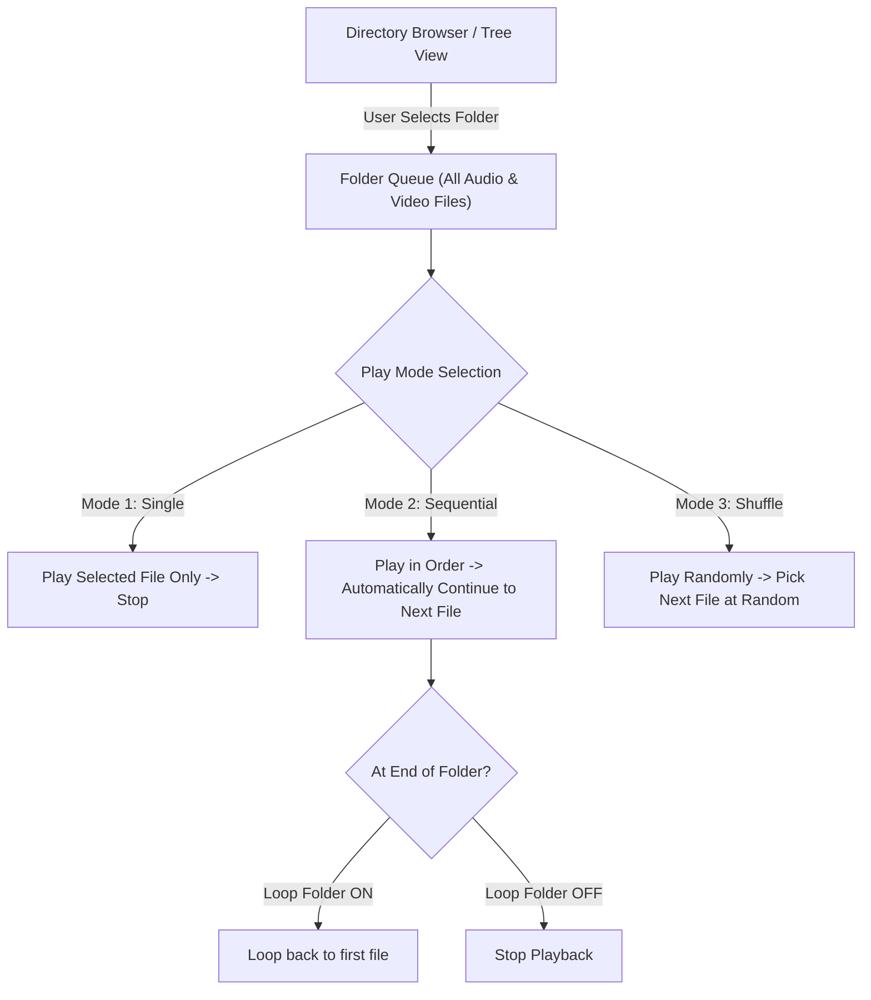

# EasyPlayer: Complete Functional Specification

**Version:** 1.0  
**Target Platforms:** Windows PC (x64) & Android (ARM64)  
**Status:** Approved Specification  

---

## 1. Product Overview & Core Vision
**EasyPlayer** is a cross-platform media player for Windows and Android engineered to play all popular audio and video formats. It combines a folder-based queue player with an on-device, offline Automatic Speech Recognition (ASR) engine capable of transcribing speech (English and Simplified Chinese) on-demand, generating synchronized subtitles and an interactive, editable transcript.

---

## 2. Media Playback & Engine Specifications

### 2.1. Supported Containers & Codecs
Powered by `libmpv` (FFmpeg backend via `media_kit`):
- **Audio**: MP3, FLAC, WAV, AAC, M4A, OGG, Opus, WMA, ALAC, AIFF, APE.
- **Video**: MP4, MKV, WebM, AVI, MOV, FLV, WMV, TS, 3GP.

### 2.2. Playback Controls
- **Core Operations**: Play, Pause, Scrub/Seek slider, Time Elapsed / Time Remaining.
- **Variable Playback Speed**: 0.5x, 0.75x, 1.0x, 1.25x, 1.5x, 2.0x with **pitch correction** enabled (voices remain natural).
- **Configurable Jump Times**:
  - Quick skip backward (Default: 5s, configurable: 3s, 5s, 10s, 15s, 30s).
  - Quick skip forward (Default: 10s, configurable: 5s, 10s, 15s, 30s, 60s).
- **Playback Position Memory (Resume Playback)**:
  - Last playback position and volume saved per file hash.
  - When re-opened, media resumes automatically from the last timestamp (with an option to restart from 0:00).
- **Subtitle Track Switching**:
  - If a media file (e.g., MKV/MP4) contains embedded subtitle tracks, the user can toggle between:
    1. *None (Off)*
    2. *Embedded Subtitle Tracks (Track 1, Track 2, etc.)*
    3. *EasyPlayer Auto-Generated Captions*

---

## 3. Directory Navigation & Queue / Playlist System

A core requirement for EasyPlayer is folder-level hierarchy navigation and flexible continuous playback.

### 3.1. Directory Structure Navigator
- Integrated in-app file browser to navigate local storage (Windows drives/directories and Android local/SD card folders).
- Filter toggle: Show All Supported Media (audio + video), or Audio Only, or Video Only.
- Shows file metadata: File name, file size, duration (if cached), and an indicator icon if a transcript is already cached.

### 3.2. Playback Order Modes
1. **Single Play**: Plays the active file and stops at the end.
2. **Sequential (Play Next - Default)**: When the current file finishes, automatically load and play the next media file in alphabetical/natural order.
3. **Random (Shuffle)**: Plays through files in the folder in a randomized non-repeating sequence.
4. **Loop Modes**: Repeat Off, Repeat Current Track, Repeat Entire Folder.

---

## 4. Speech-to-Text & Caption Generation System

### 4.1. Language Scope & Model Strategy
- **Supported Languages**: **English** and **Simplified Chinese (简体中文)**.
- **Model Quality Tier**: **"Accurate" Mode**.
  - Engine: On-device quantized model (~140–150 MB).
  - Candidate models:
    - *Whisper Base/Small Multilingual (INT8)*: Outstanding English + Chinese with word timestamps.
    - *SenseVoice-Small (Sherpa-ONNX)*: Extremely accurate on Chinese + English, 5x faster than Whisper on mobile CPUs.
- **Model Bundling & Unpacking**:
  - Model weights bundled in app package.
  - On first application launch, weights are verified/extracted to the application's local support directory. Zero network download required.

### 4.2. On-Demand Progressive Transcription
- **Instant Media Playback**: Media plays immediately when opened.
- **CC Toggle**:
  - When the user presses the **CC (Closed Captions)** button:
    1. System checks local cache for `<media_hash>.vtt`.
    2. If found, load instantly.
    3. If not found, a background worker (Dart Isolate) is spawned.
- **Background Worker Pipeline**:
  - Extracts/resamples audio track into 16kHz 16-bit PCM mono.
  - Feeds audio in chunks to the ASR inference engine.
  - Emits progressive subtitle cues `{ id, startMs, endMs, text }` to a reactive stream so captions begin appearing on screen before the entire file finishes transcribing.
  - Once complete, saves the full transcript to local disk.

---

## 5. Subtitle Display, Interactive Transcript & Editing

### 5.1. On-Screen Video Subtitle Overlay
- **Font Size**: Adjustable via slider or presets (Small, Medium, Large, Extra Large).
- **Color & Styling**: Adaptive white text with black semi-transparent bounding box / stroke outline to ensure high contrast against any video background.
- Position: Standard bottom-center (with margin adjustment to not block media controls).

### 5.2. Interactive Transcript Panel (Side / Collapsible View)
- **Click-to-Seek**: Clicking any sentence or phrase immediately seeks the audio/video player to that exact millisecond.
- **Active Cue Highlighting**: Active sentence is highlighted with visual contrast and distinct background pill.
- **Auto-Scroll Behavior**:
  - **Locked (Default)**: Automatically scrolls the transcript list to keep the current sentence centered in view.
  - **Manual Override**: If the user manually scrolls up/down to browse, auto-scroll pauses. A floating "Resume Auto-scroll" button appears to re-lock view to current playback.
- **In-Transcript Search**:
  - Search bar with real-time text filter.
  - Shows match count (e.g., `3 of 14`).
  - Next/Previous jump arrows to step through matching sentences.

### 5.3. Inline Editing & Persistence
- User can double-click (Windows) or tap "Edit" (Android) on any transcript block to correct recognized text (e.g. proper nouns, technical terms).
- Edited transcript is updated in memory and automatically re-saved to the cached `.vtt` / `.json` file on disk.

### 5.4. Transcript Export (Windows PC)
- On Windows PC, the user can export the generated transcript to:
  1. SubRip Subtitle (`.srt`)
  2. WebVTT (`.vtt`)
  3. Plain Text with/without timestamps (`.txt`)

---

## 6. Platform-Specific Specifications

### 6.1. Android Experience
- **Background Audio Playback**:
  - When playing audio files: Audio continues uninterrupted when the screen is turned off or when switching to other apps.
  - Managed via an Android Foreground Service.
- **Lock-Screen & System Notification**:
  - Media style notification displaying: Title, Folder name, Play/Pause toggle, Previous Track, Next Track, and Seek bar.
- **Video Behavior**:
  - Follows standard media player conventions: When minimized, video pauses by default.
- **Storage Access**:
  - Utilizes Android Storage Access Framework (SAF) and `MANAGE_EXTERNAL_STORAGE` / MediaStore permissions to navigate user directories.

### 6.2. Windows PC Experience
- **Keyboard Shortcuts (Hotkeys)**:
  | Key | Action |
  | :--- | :--- |
  | `Space` | Play / Pause toggle |
  | `Left Arrow` / `Right Arrow` | Skip backward / forward (configurable seconds) |
  | `J` / `L` | Seek -10s / +10s (YouTube style) |
  | `K` | Play / Pause |
  | `Up Arrow` / `Down Arrow` | Volume Up / Volume Down (+/- 5%) |
  | `M` | Mute / Unmute toggle |
  | `F` / `Escape` | Enter / Exit Fullscreen |
  | `C` | Toggle Closed Captions (On / Off) |
  | `[` / `]` | Decrease / Increase Playback Speed (by 0.25x) |
- **Drag-and-Drop**:
  - Dragging any media file onto the window plays it immediately.
  - Dragging a folder onto the window loads the folder into the queue and starts playing from the first file.

---

## 7. Configuration & Persistent Settings

The application stores settings locally in SQLite / shared preferences:
1. `skip_backward_seconds` (integer, default: 5)
2. `skip_forward_seconds` (integer, default: 10)
3. `playback_speed` (double, default: 1.0)
4. `subtitle_font_size` (double, default: 18.0)
5. `play_mode` (enum: `single`, `sequential`, `shuffle`)
6. `repeat_mode` (enum: `none`, `track`, `folder`)
7. `recent_directories` (list of paths)
8. `playback_positions` (key-value map: `file_hash -> position_ms`)
